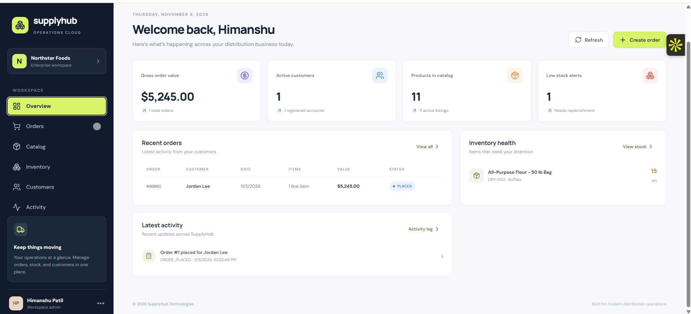
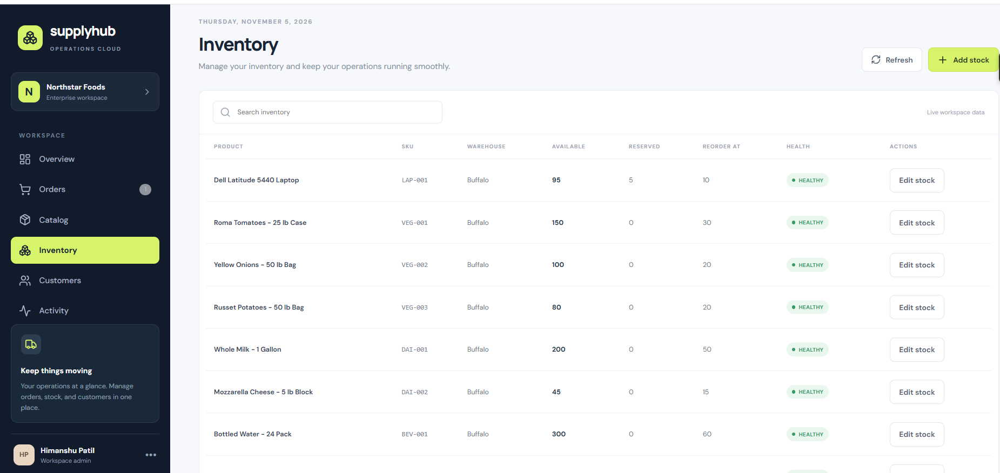
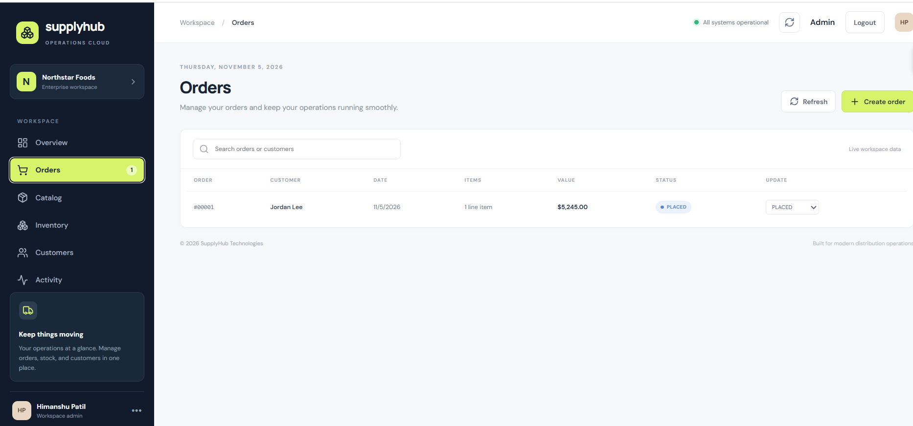
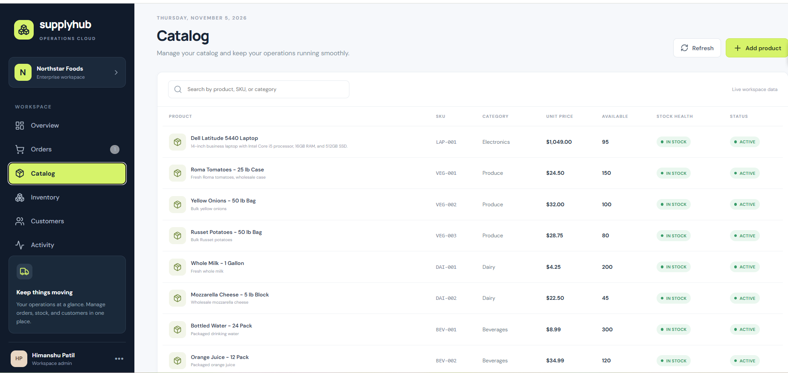
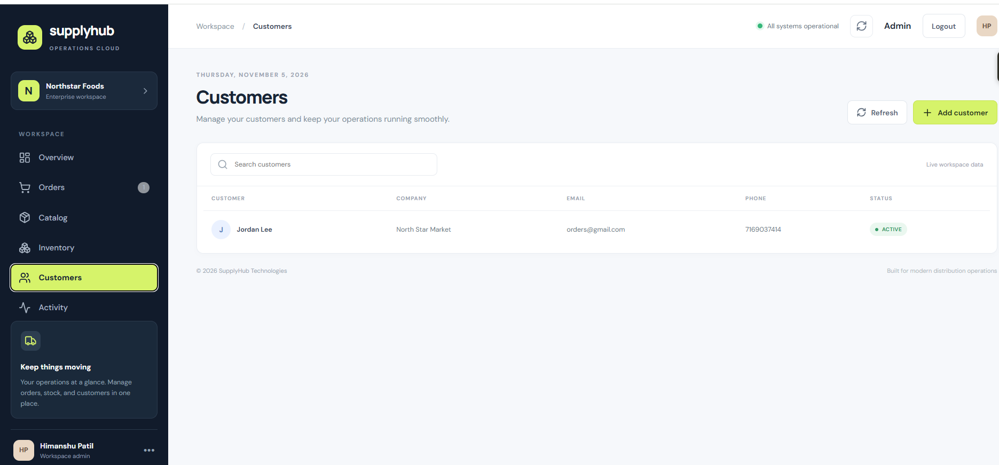
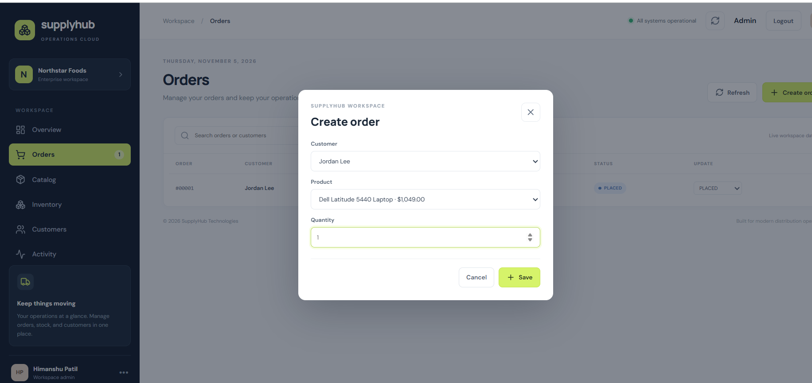
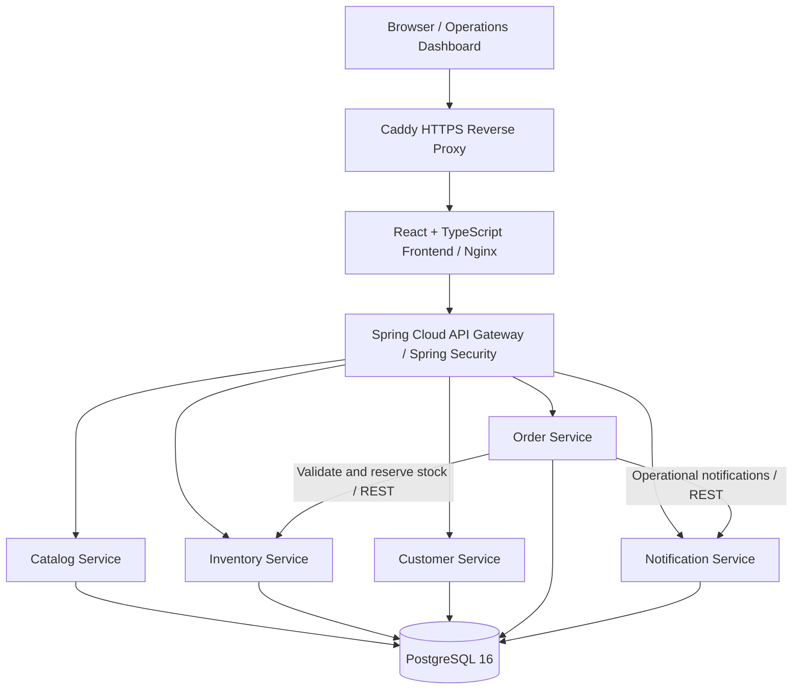
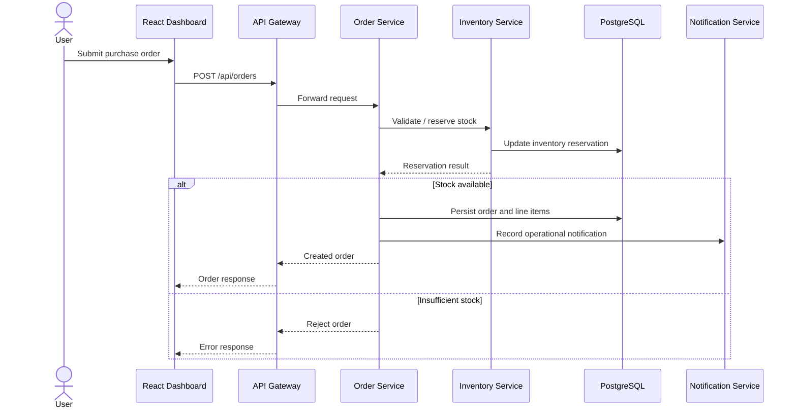

# SupplyHub — B2B Supply Chain & Order Management Platform

**A full-stack supply chain management application built with Java, Spring Boot microservices, React, TypeScript, PostgreSQL, and Docker, deployed on AWS EC2.**

[](https://www.java.com/)
[](https://spring.io/projects/spring-boot)
[](https://react.dev/)
[](https://www.postgresql.org/)
[](https://www.docker.com/)

**Live application:** [supplyhub.duckdns.org](https://supplyhub.duckdns.org)  
**Source code:** [github.com/himanshupatil208/supplyhub-platform](https://github.com/himanshupatil208/supplyhub-platform)

> **Demo availability:** The live environment runs on a personal AWS EC2 instance and may occasionally be offline. Administrative actions require credentials; credentials are not published in this repository.

## Overview

SupplyHub models the operational workflow of a wholesale distributor: maintaining a product catalog, tracking warehouse stock, managing customers, placing purchase orders, reserving inventory, and recording operational notifications.

The application separates business capabilities into **five independently deployable Spring Boot services**, exposed through **Spring Cloud Gateway** and consumed by a **React + TypeScript** operations dashboard. Each service owns a separate PostgreSQL schema, reducing coupling at the persistence layer.

## Application Screenshots

The screenshots below demonstrate the deployed React/TypeScript operations dashboard and its core workflows. Screenshots are stored in [`docs/screenshots/`](docs/screenshots/) and should be captured from the running application using fictional demo data. **Add the six image files before publishing this section**, otherwise GitHub will display broken image links.

### Overview Dashboard



### Inventory Management



### Order Management



### Product Catalog



### Customer Management



### Create Purchase Order



## Features

- **Product catalog:** Create and manage products with SKU, category, description, unit price, and active status.
- **Inventory management:** Track available and reserved quantities, warehouses, and reorder thresholds.
- **Customer management:** Maintain distributor customer records.
- **Order management:** Create purchase orders with line items, calculate totals, and manage order status.
- **Inventory reservation:** Validate and reserve stock through service-to-service REST communication during order creation.
- **Notifications:** Persist operational events and notifications.
- **Operations dashboard:** React/TypeScript interface for interacting with the backend services.
- **API gateway security:** Centralized routing and Spring Security HTTP Basic authentication for protected administrative endpoints.
- **Deployment:** Containerized services on AWS EC2 with HTTPS provided by Caddy and Let's Encrypt.

## Technology Stack

| Layer | Technologies |
| --- | --- |
| Backend | Java 21, Spring Boot 3.3.5, Spring Web, Spring Data JPA, Bean Validation |
| Gateway and security | Spring Cloud Gateway, Spring Security, HTTP Basic authentication |
| Frontend | React, TypeScript, Vite, Lucide React |
| Database | PostgreSQL 16, separate schemas per service |
| Service communication | REST APIs, Spring `RestClient` |
| Containers | Docker, Docker Compose |
| Cloud and delivery | AWS EC2, GitHub Actions, GitHub Container Registry (GHCR) |
| Reverse proxy and TLS | Nginx (frontend container), Caddy, Let's Encrypt |

## Architecture



All application services run in Docker containers on the EC2 host. The production frontend container binds to `127.0.0.1:8088`; Caddy terminates public HTTPS and proxies traffic to the frontend. Nginx serves the frontend and forwards API traffic to the gateway. Backend services and PostgreSQL are not directly exposed as public application endpoints by the production Compose configuration.

### Microservices

| Component | Local port | Responsibility | PostgreSQL schema |
| --- | ---: | --- | --- |
| API Gateway | 8080 | Route `/api/**` traffic and enforce endpoint authentication | — |
| Catalog Service | 8081 | Product catalog | `catalog` |
| Inventory Service | 8082 | Stock levels, adjustments, reservations | `inventory` |
| Customer Service | 8083 | Customer records | `customers` |
| Order Service | 8084 | Purchase orders, line items, totals, status | `orders` |
| Notification Service | 8085 | Operational notifications | `notifications` |
| Frontend (Vite development) | 5173 | Operations dashboard | — |

> The service ports above describe the application and local-development configuration. In production, requests enter through HTTPS; individual service ports are not published to the internet.

### Database ownership

The application uses one PostgreSQL server with logically isolated schemas:

```text
supplyhub (PostgreSQL database)
├── catalog
│   └── products
├── inventory
│   └── stock_items
├── customers
│   └── customers
├── orders
│   ├── purchase_orders
│   └── order_lines
└── notifications
    └── notifications
```

Services own their tables and communicate across service boundaries via APIs rather than directly querying another service's schema. Database storage is persisted in a Docker named volume.

## Order Processing Flow



**Design trade-off:** Stock reservation and order persistence span separate services. This project uses synchronous REST calls; it does **not** implement a distributed transaction protocol. A production-grade evolution would add idempotency, a transactional outbox, and saga/compensation handling for partial failures.

## Repository Structure

```text
supplyhub-platform/
├── database/
│   └── init.sql
├── frontend/                   # React + TypeScript dashboard
├── services/
│   ├── api-gateway/
│   ├── catalog-service/
│   ├── inventory-service/
│   ├── customer-service/
│   ├── order-service/
│   └── notification-service/
├── docker-compose.yml         # Local build-and-run
├── docker-compose.prod.yml    # Production container images
└── README.md
```

## Getting Started Locally

### Prerequisites

- Docker Engine with Docker Compose plugin (or Docker Desktop)
- Git
- Optional for running services outside Docker: **Java 21**, Maven, and **Node.js 20+**

### 1. Clone the repository

```bash
git clone https://github.com/himanshupatil208/supplyhub-platform.git
cd supplyhub-platform
```

### 2. Configure the environment

Create a `.env` file in the repository root:

```dotenv
POSTGRES_PASSWORD=replace-with-a-strong-local-password
```

Use a unique password. Do **not** commit `.env` or any real credentials.

### 3. Build and start

```bash
docker compose up --build -d
```

The first build may take several minutes while Java and frontend dependencies are downloaded. PostgreSQL initializes its database and schemas on first startup.

### 4. Open the application

| Endpoint | Local URL |
| --- | --- |
| Frontend | http://localhost:5173 |
| API Gateway | http://localhost:8080 |
| Gateway health | http://localhost:8080/actuator/health |

> Protected API operations may require admin credentials. Local gateway authentication configuration can differ from the production deployment; check the gateway security configuration before attempting protected requests.

### 5. View logs or stop the application

```bash
# Container status
docker compose ps

# Follow service logs
docker compose logs -f api-gateway

# Stop containers while retaining database data
docker compose down
```

Avoid `docker compose down -v` unless you intentionally want to delete the database volume.

## API Examples

The gateway routes these API prefixes:

| API prefix | Purpose |
| --- | --- |
| `/api/catalog/**` | Products and catalog operations |
| `/api/inventory/**` | Stock and reservations |
| `/api/customers/**` | Customer records |
| `/api/orders/**` | Purchase orders |
| `/api/notifications/**` | Notifications |

The following examples target a **local development gateway**. Protected operations require the authentication configured for your environment.

### List products

```bash
curl http://localhost:8080/api/catalog/products
```

### Create a product

```bash
curl -X POST http://localhost:8080/api/catalog/products \
  -H 'Content-Type: application/json' \
  -d '{
    "sku": "TOM-001",
    "name": "Roma Tomatoes",
    "description": "Fresh Roma tomatoes, 25 lb case",
    "category": "Produce",
    "unitPrice": 24.50,
    "active": true
  }'
```

### Add stock

```bash
curl -X POST http://localhost:8080/api/inventory/stock \
  -H 'Content-Type: application/json' \
  -d '{
    "sku": "TOM-001",
    "productName": "Roma Tomatoes",
    "availableQuantity": 100,
    "reorderLevel": 20,
    "warehouse": "Buffalo"
  }'
```

### Create a customer

```bash
curl -X POST http://localhost:8080/api/customers \
  -H 'Content-Type: application/json' \
  -d '{
    "name": "North Star Market",
    "email": "orders@northstar.example",
    "phone": "716-555-0100",
    "company": "North Star Foods"
  }'
```

### Place an order

The customer and SKU should already exist, and the SKU should have sufficient available stock.

```bash
curl -X POST http://localhost:8080/api/orders \
  -H 'Content-Type: application/json' \
  -d '{
    "customerId": 1,
    "customerName": "North Star Market",
    "items": [
      {
        "sku": "TOM-001",
        "productName": "Roma Tomatoes",
        "quantity": 2,
        "unitPrice": 24.50
      }
    ]
  }'
```

For authenticated environments, supply the configured credentials through your HTTP client or a secure environment variable. Do not paste credentials into shared shell history, screenshots, or documentation.

## Production Deployment (AWS EC2)

The deployed environment uses **Amazon Linux 2023**, Docker Compose, prebuilt images from **GitHub Container Registry**, and a host-level **Caddy** reverse proxy.

### Production request path

```text
https://supplyhub.duckdns.org
        |
        v
Caddy (TLS termination, ports 80/443)
        |
        v
127.0.0.1:8088 -> Frontend Nginx container
        |
        +--> React/TypeScript static assets
        |
        +--> /api/* -> api-gateway:8080 -> Spring Boot services
```

### Production environment

On the EC2 host, create a `.env` file alongside `docker-compose.prod.yml`:

```dotenv
POSTGRES_PASSWORD=replace-with-a-strong-database-password
SUPPLYHUB_ADMIN_PASSWORD=replace-with-a-strong-admin-password
IMAGE_TAG=latest
```

**Never commit production credentials.** If a credential is exposed, rotate it and restart the affected services.

### Pull and start the production stack

```bash
docker compose -f docker-compose.prod.yml pull
docker compose -f docker-compose.prod.yml up -d
docker compose -f docker-compose.prod.yml ps
```

The production Compose configuration:

- Uses GHCR images for the gateway, five business services, and frontend.
- Runs PostgreSQL 16 with a persistent named volume.
- Waits for PostgreSQL health before starting database-dependent services.
- Restarts containers unless explicitly stopped.
- Publishes the frontend only on `127.0.0.1:8088:80`.
- Supplies the admin password to the API Gateway through an environment variable.

### HTTPS with Caddy

The EC2 host runs Caddy with a site configuration equivalent to:

```caddyfile
supplyhub.duckdns.org {
    encode zstd gzip
    reverse_proxy 127.0.0.1:8088
}
```

Caddy handles HTTPS certificate issuance and renewal through Let's Encrypt. DNS must resolve to the current EC2 public IP, and the instance security group must permit inbound TCP 80 and 443. Restrict SSH access to trusted IP addresses.

### Inspect production health and logs

```bash
docker compose -f docker-compose.prod.yml ps
docker compose -f docker-compose.prod.yml logs --tail=100 api-gateway
curl -I https://supplyhub.duckdns.org
```

### Inspect the production database

```bash
docker compose -f docker-compose.prod.yml exec postgres \
  psql -U supplyhub -d supplyhub
```

Inside `psql`:

```sql
\dt catalog.*
\dt inventory.*
\dt orders.*

SELECT sku, name, unit_price FROM catalog.products ORDER BY id;
SELECT sku, available_quantity, reserved_quantity, reorder_level
FROM inventory.stock_items ORDER BY id;
```

Type `\q` to exit. Prefer using the application's APIs for operational writes; direct database modifications bypass service validation and workflows.

## CI/CD and Container Images

The project uses **GitHub Actions** to build and publish application container images to **GHCR**. The production Compose file references those images using the `IMAGE_TAG` environment variable.

Deployment to EC2 uses an explicit pull-and-recreate step:

```bash
docker compose -f docker-compose.prod.yml pull
docker compose -f docker-compose.prod.yml up -d
```

**Important:** Publishing an image is not the same as automatically deploying it. Fully automated remote deployment is a possible future enhancement; this README does not assume it is already configured.

## Security and Reliability Considerations

**Implemented:**

- Centralized gateway routing and Spring Security authentication for protected routes.
- Database separation by service schema.
- Input validation through Spring Bean Validation.
- Transactional writes within individual services.
- HTTPS termination through Caddy.
- Container restart policies and a PostgreSQL health check.
- No public database port in the production Compose configuration.

**Current limitations:**

- HTTP Basic authentication is not a complete identity-management solution; a future version could use OAuth2/OIDC and robust role-based authorization.
- Synchronous service calls need stronger resilience for partial failures and retries.
- The order-to-inventory workflow does not provide atomic transactions across services.
- No production payment processor is integrated; payment handling is simulated.
- A single EC2 host and PostgreSQL instance do not provide high availability.

## Future Improvements

- Add OAuth2/OIDC authentication, fine-grained authorization, and improved frontend login handling.
- Introduce Kafka or RabbitMQ for asynchronous order and notification events.
- Implement transactional outbox, idempotency keys, and saga compensation for distributed workflows.
- Add Flyway or Liquibase migrations and automated database backups.
- Add distributed tracing with OpenTelemetry and centralized metrics/logging.
- Expand integration, contract, and end-to-end test coverage.
- Automate EC2 rollout and add staged deployments/rollback procedures.
- Add rate limiting, request correlation IDs, and service resilience policies.

## License

No license is specified in this repository README. Unless a license file is added, do not assume the source code is licensed for reuse.

---

**SupplyHub** demonstrates practical full-stack software engineering: modular Spring Boot services, API gateway design, service-to-service communication, relational persistence, React/TypeScript UI development, containerization, and deployment of a working application to AWS.
